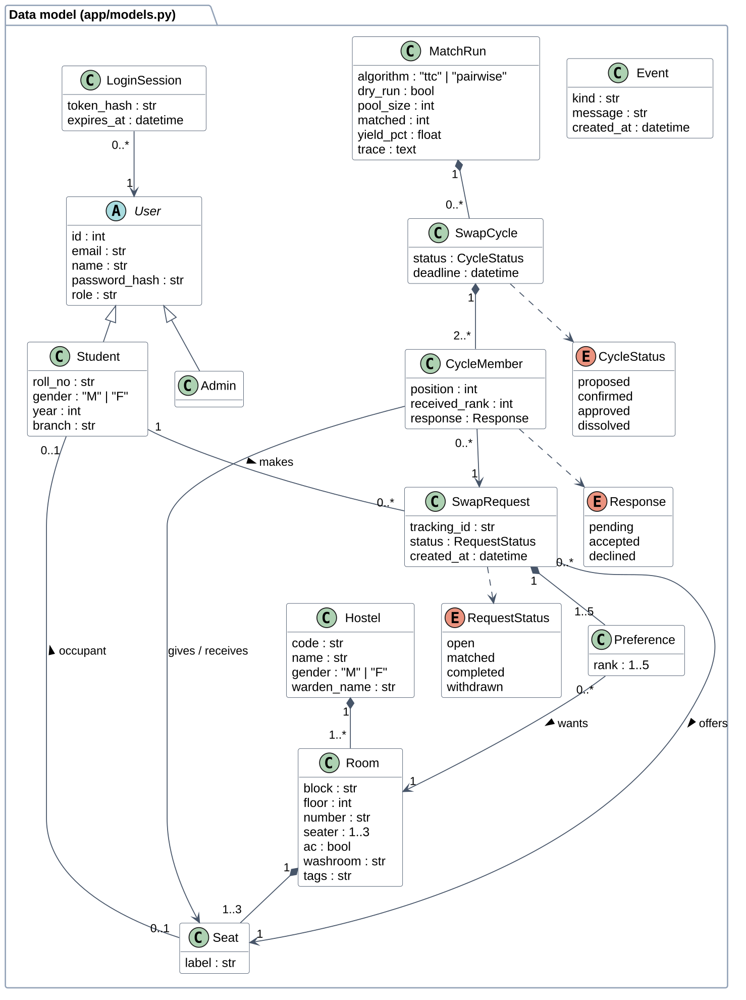
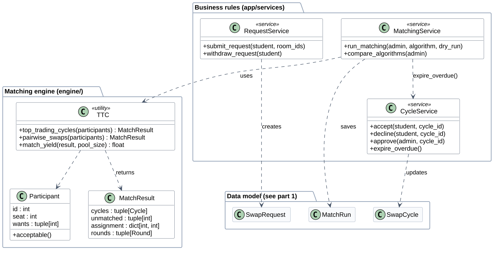
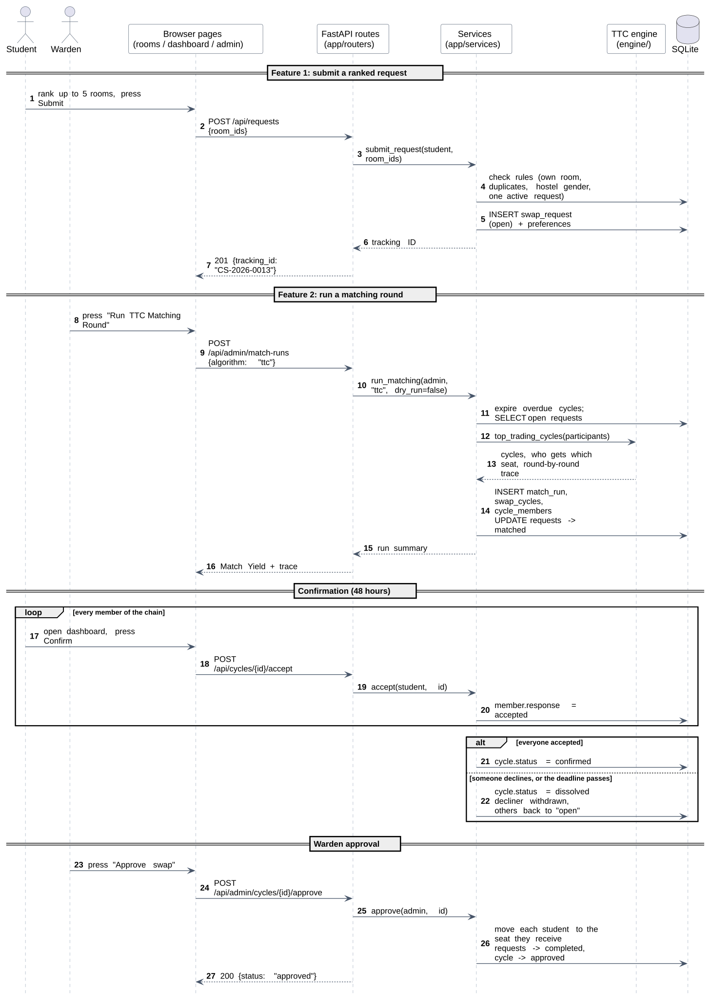
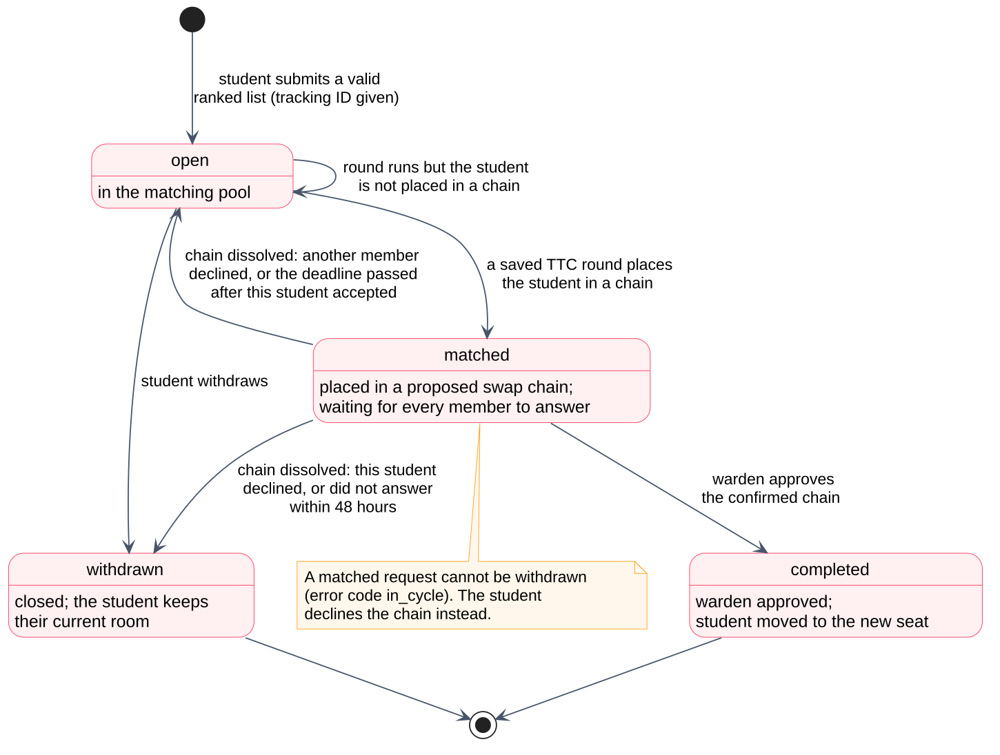
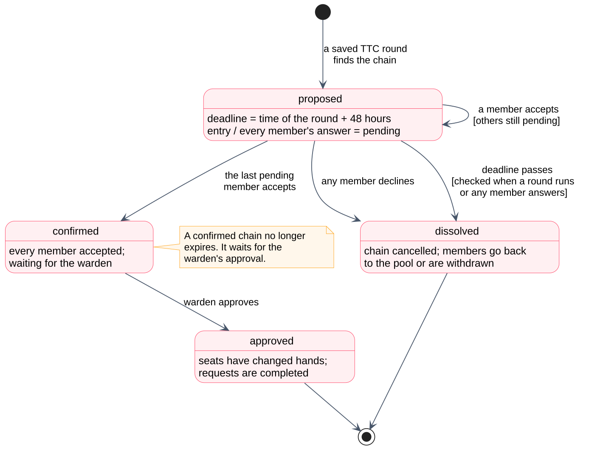
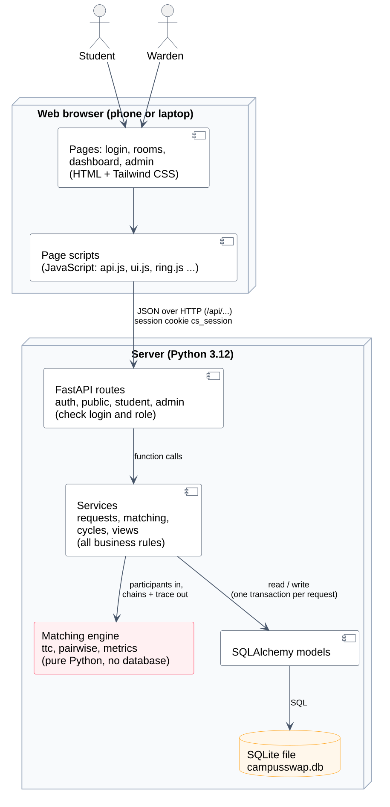
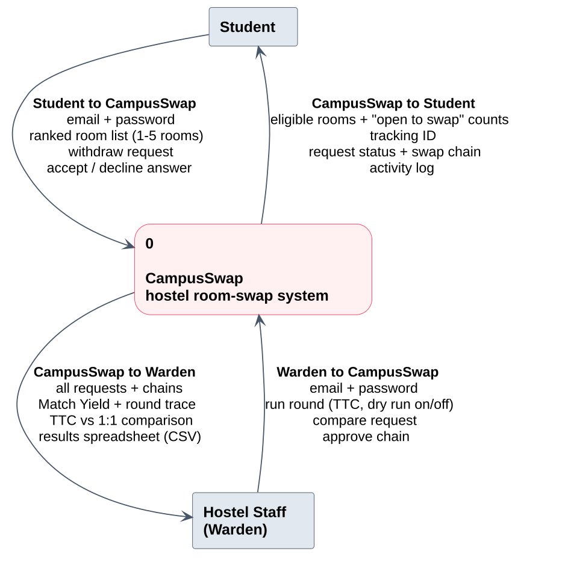
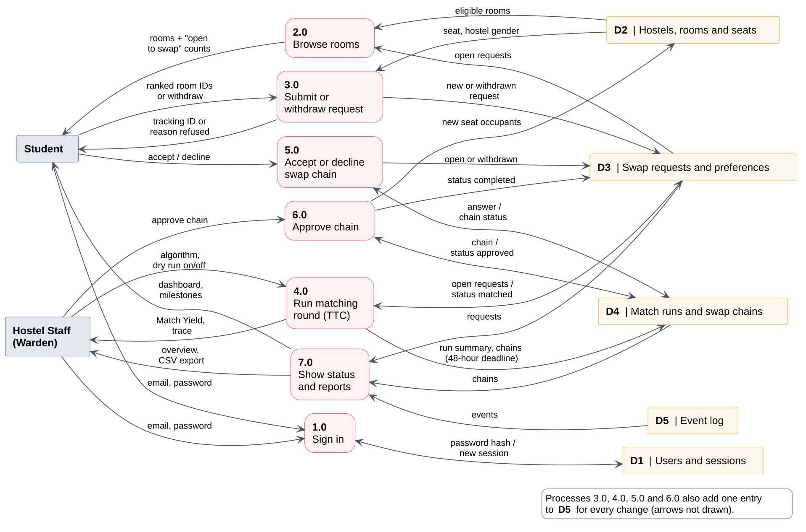
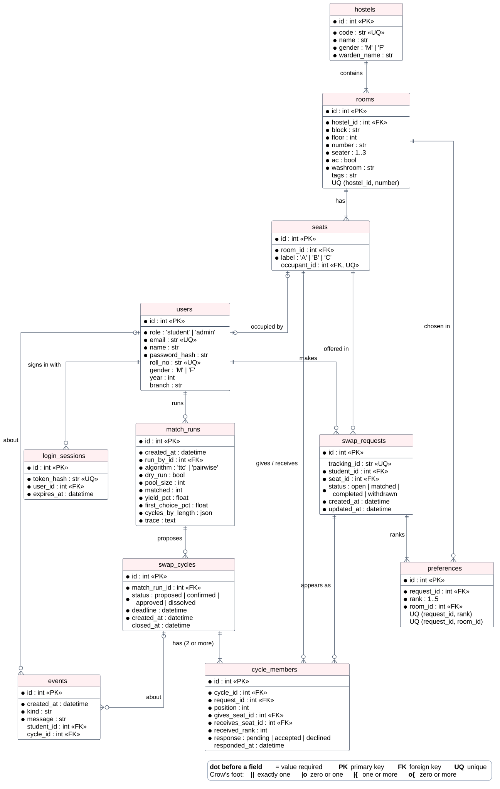

# Diagrams

Sources are in `diagrams/*.puml` (PlantUML text). Re-draw them with
`python diagrams/render.py` (or `python diagrams/render.py er state-cycle` for just those
two). Each diagram below comes with the reasons behind its relationships, because the lab
asks us to justify them. The same images are used in the SRS (`srs/main.tex`).

## Use Case diagram

**Actors.** *Student* and *Hostel Staff (Warden)* are the two kinds of people who use the
system. There is no clock actor: in the prototype the 48-hour deadline is checked when
something happens, not by a timer.

**Why these relationships:**

- *Submit ranked swap request* **«include»** *Validate request*: every submission is
  always validated; it is a mandatory part of submitting, not an optional extra.
- *Run TTC matching round*, *Confirm swap* and *Decline swap* **«include»** *Expire
  unanswered swaps*: each of them first dissolves chains whose deadline has passed
  (see `expire_overdue()` in `services/cycles.py`).
- *Preview round (dry run)* **«extend»** *Run TTC matching round*: a dry run is an
  optional variation of running a round that the warden switches on; the base use case
  works without it.
- *Compare TTC with 1:1-only swaps* **«include»** *Preview round (dry run)*: a
  comparison always runs both methods as dry runs.

## Class diagram

The class diagram is drawn in two parts so each stays readable when printed: part 1 is the
domain model (`app/models.py`), part 2 the services that hold the business rules and the
matching engine. In part 2 the three data classes the services use appear by name only;
their attributes are in part 1.

**Why these relationships:**

- **Generalisation** *Student* and *Admin* → *User*: both log in the same way and share
  email, name and password hash; students add roll number, gender, year and branch.
- **Composition** (filled diamond) *Hostel* ◆— *Room* ◆— *Seat*: a room can't exist
  without its hostel, nor a seat without its room.
- **Composition** *SwapRequest* ◆— *Preference* (1..5): the ranked choices belong to one
  request and have no meaning on their own.
- **Composition** *MatchRun* ◆— *SwapCycle* ◆— *CycleMember* (2..*): a chain is produced
  by one run and always has at least two members.
- **Association** *Seat* — *Student* (0..1 to 0..1): a bed has at most one occupant, and a
  student has at most one bed. It's an association, not composition, because students
  exist on their own and move between seats.
- **Dependencies** (dashed arrows, part 2) from the services: *MatchingService* uses the
  *TTC* engine and calls *CycleService*'s `expire_overdue()`. They don't store each other,
  so these are dependencies, not associations.

## Sequence diagram

One swap from start to finish: feature 1 (submit), feature 2 (run a round), the
confirmation **loop** over every chain member, the **alt** block for "everyone accepted"
versus "someone declined / deadline passed", and the warden's approval. Messages follow
the real layers: page → route → service → engine or database.

## Activity diagram

The life of one swap request, with swimlanes for *Student*, *System* and *Warden*. Two
loops show what happens when things don't work first time: an invalid request goes back to
browsing, and a student not placed in a chain stays in the pool for the next round. The
final decision shows the two ways a proposed swap can end: **confirmed then approved**, or
**dissolved**.

## State diagrams

Each box is a status a row can have in the database; each arrow is the event that moves it
on. They match the status tables in [Data model](data-model.md). Two details worth
remembering: a **matched** request can't be withdrawn (the student declines the chain
instead), and a **confirmed** chain no longer expires; only a **proposed** one does.

## Architecture

The three layers and the separate engine from [Architecture](architecture.md). Each layer
talks only to the one next to it, and the engine has no database code.

## Data flow diagrams

Gane–Sarson notation: square boxes are people outside the system, rounded boxes are
processes, and boxes with a D number are data stores. **Level 0** shows the whole system
as one process and what flows in and out. **Level 1** splits it into the seven processes
(sign in, browse, submit/withdraw, run a round, answer a chain, approve, report) and the
five stores. Every arrow carries data, not a trigger. To keep Level 1 readable, the four
"add an event" arrows from processes 3.0–6.0 into D5 are listed in the legend instead of
drawn.

## ER diagram

The real tables from `app/models.py` in crow's foot notation (`||` exactly one, `o{`
zero or more, `|{` one or more). Unlike the class diagram, it shows primary keys, foreign
keys and unique rules, for example `seats.occupant_id` being unique (one student per bed).
